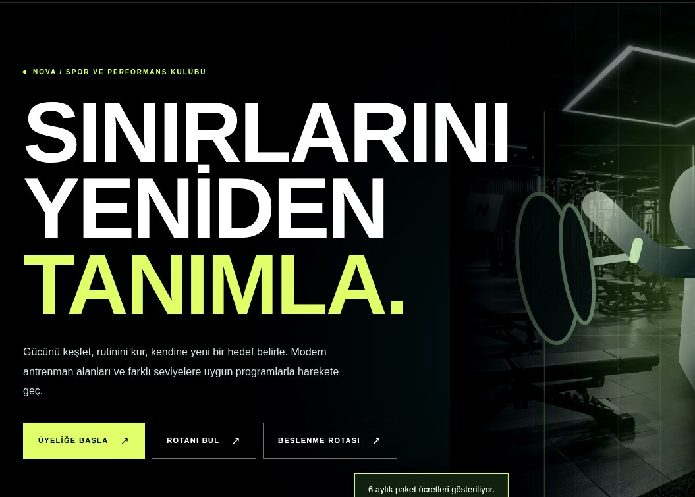
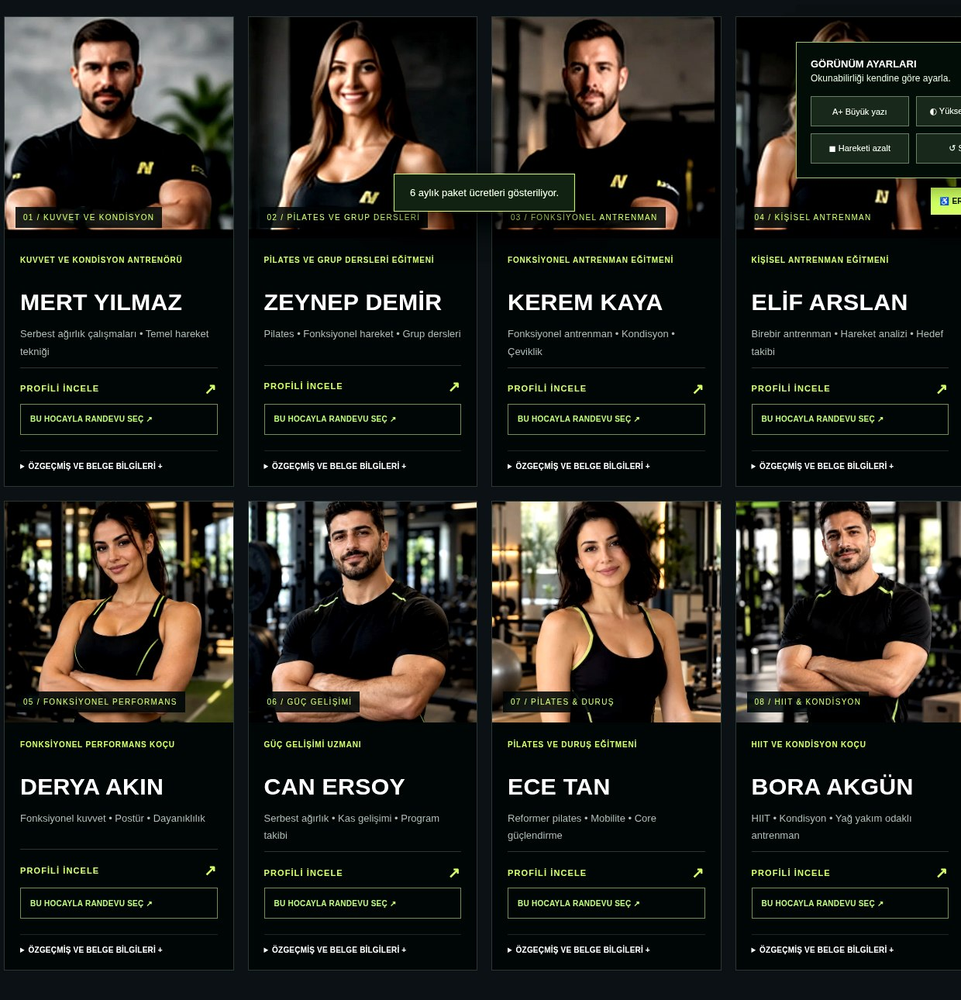
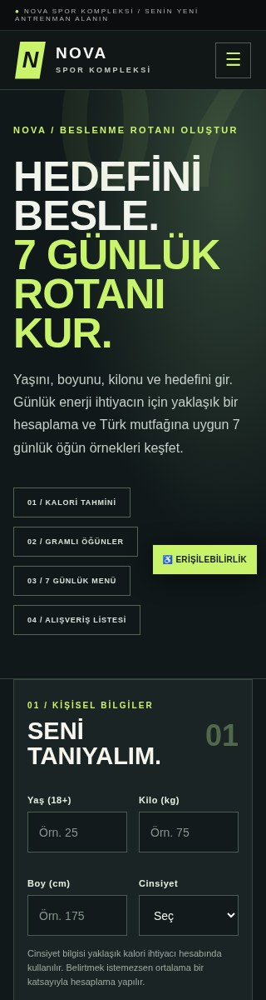

# NOVA Spor Kompleksi

**WordPress tabanlı spor ve wellness yönetim sitesi — akademik proje**

NOVA Spor Kompleksi; bir spor tesisinin hizmetlerini, eğitim programlarını, antrenörlerini, üyelik seçeneklerini ve başvuru süreçlerini aynı arayüzde buluşturan, Türkçe ve mobil uyumlu bir WordPress tema projesidir. Tasarımın odağında koyu grafit zemin, lime yeşili vurgu rengi ve hızlı erişilebilen kullanıcı işlemleri vardır.

> **Proje durumu:** Akademik/demonstrasyon amaçlıdır. Buradaki ücretler, antrenör profilleri ve işletme konumu örnek içeriklerdir. Randevu formları **başvuru talebi** oluşturur; otomatik kesin rezervasyon veya ödeme gerçekleştirmez. Envato Market tanıtımı, yayımlanmış bir ürün/satış ilanı değildir.



## Özellikler

| Modül | Açıklama |
| --- | --- |
| Ana sayfa | Kurumsal tanıtım, hızlı bağlantılar, örnek Önce/Sonra görselleri ve konum alanı |
| Antrenörler | Sekiz örnek eğitmen profili, uzmanlık ve eğitim bilgileri |
| PT ve eğitimler | Antrenör seçimi, örnek seans paketleri ve fiyatları, randevu talebi |
| Grup dersleri | Haftalık program, tür/seviye filtreleri ve ders başvuru talebi |
| Salon kiralama | Kiralanabilir salonlar, açıklamalar ve tarih/saatli talep formu |
| Üyelikler | Üyelik paketleri, başvuru ve yenileme talepleri |
| Hesaplar | WordPress kullanıcı altyapısı üzerinden üye kaydı/girişi ve onaylı PT yetkisi |
| Yönetim | `NOVA Başvuruları` ve PT onaylarını WordPress panelinden inceleme |
| Beslenme Rotası | Yaklaşık enerji hesabı ve yedi günlük örnek yemek planı; tıbbi danışmanlık değildir |
| Rotanı Bul | Hedefe göre örnek egzersiz/üyelik yönlendirmesi |
| Harita | WP Go Maps ile sitenin içinde gösterilen örnek Bursa/Nilüfer konumu |
| Erişilebilirlik | Yazı ölçeği, kontrast, hareket azaltma gibi arayüz yardımcıları |
| İletişim | WordPress `wp_mail()` altyapısıyla çalışan başvuru formu (SMTP yapılandırması gerekir) |

## Ekran görüntüleri

| Antrenörler | Mobil beslenme ekranı |
| --- | --- |
|  |  |

## Teknolojiler

- **WordPress:** Sayfa şablonları, roller, kullanıcılar, yönetim arayüzü ve AJAX uçları
- **PHP:** Tema, başvuru kayıtları ve kullanıcı işlemleri
- **MySQL/MariaDB:** WordPress veritabanı (site kurulumuna ait; repoda gerçek veritabanı bulunmaz)
- **HTML, CSS, JavaScript:** Etkileşimli, responsive kullanıcı arayüzü
- **XAMPP:** Yerel geliştirme ortamı (Apache + MySQL/MariaDB)
- **WP Go Maps:** Site içine yerleştirilen harita için önerilen eklenti
- **WP Mail SMTP:** Giden posta teslimini yapılandırmak için önerilen eklenti

## Kurulum (yerel ortam / XAMPP)

1. XAMPP içinden **Apache** ve **MySQL** servislerini başlatın.
2. WordPress'i örneğin `C:\xampp\htdocs\spor-kompleksi` konumunda kurun. Yerel kurulumun veritabanını ve WordPress yönetici hesabını oluşturun.
3. Bu depodaki `wordpress-theme/nova-spor-kompleksi/` klasörünü `wp-content/themes/` altına kopyalayın. Alternatif olarak klasörü ZIP'leyip WordPress panelinden **Görünüm → Temalar → Yeni Ekle → Tema Yükle** yoluyla kurun.
4. **Görünüm → Temalar** üzerinden `NOVA Spor Kompleksi` temasını etkinleştirin.
5. WordPress panelinde **Ayarlar → Kalıcı Bağlantılar → Değişiklikleri Kaydet** işlemini yapın.
6. İstenirse **WP Go Maps** eklentisini kurup `id=1` numaralı haritayı Bursa/Nilüfer örnek konumuna ayarlayın. Harita numarası farklıysa tema özelleştiricisindeki NOVA harita ayarını düzenleyin.
7. E-posta iletiminde **WP Mail SMTP** yapılandırın ve deneme e-postası gönderin.
8. Üye/PT hesabı, randevu talebi ve yönetim ekranlarını kendi yerel WordPress sitenizde test edin.

**Not:** GitHub bağlantısı bir kod deposudur, çalışan canlı WordPress sitesi değildir. `localhost` yalnızca siteyi barındıran bilgisayardan (veya ayrıca yapılandırılmış yerel ağdan) erişilebilir. GitHub Pages, WordPress PHP/MySQL uygulamasını doğrudan çalıştırmaz.

## Proje yapısı

Tema kökü; `style.css`, `functions.php`, `index.php`, `front-page.php`, `page.php`,
`header.php`, `footer.php`, `404.php`, `screenshot.png` ve `KURULUM.txt` dosyalarını
içerir. Tema yardımcıları `inc/accounts.php` ve `inc/requests.php` altında; uygulama
şablonu `template-parts/site-app.php` altında; CSS, JavaScript ve görseller ise sırasıyla
`assets/css/`, `assets/js/` ve `assets/img/` altındadır. Belgelerdeki üç ekran görüntüsü
`docs/screenshots/` altında, teslim rehberi de `docs/TESLIM_REHBERI.md` konumundadır.

```text
NOVA-Spor-Kompleksi/
├── README.md
├── .gitignore
├── SECURITY.md
├── wordpress-theme/
│   └── nova-spor-kompleksi/
│       ├── functions.php
│       ├── style.css
│       ├── front-page.php
│       ├── template-parts/
│       ├── inc/
│       └── assets/
└── docs/
    ├── NOVA_Sistem_Kullanim_Kitapcigi.pdf
    └── screenshots/
```

## Yönetim ve başvuru akışı

- **Ziyaretçi:** Programları, antrenörleri ve üyelikleri inceler; uygun formdan başvuru/talep gönderir.
- **Üye:** WordPress tabanlı kullanıcı hesabı oluşturur, giriş yapar ve kendi hesabı için sunulan işlemleri kullanır.
- **PT başvurusu:** İlk kayıt yönetici onayı olmadan PT yetkisi kazandırmaz.
- **Yönetici:** WordPress panelindeki **NOVA Başvuruları** ve ilgili kullanıcı/onay ekranlarında talepleri inceler.
- **Rezervasyon:** Talebin kaydedilmesi kesin rezervasyon/ödeme anlamına gelmez; yönetici işlemi ve uygunluk doğrulaması gereklidir.

## Belgeler ve ders teslimi

Detaylı kullanım kılavuzu: [NOVA Sistem Kullanım Kitapçığı (PDF)](docs/NOVA_Sistem_Kullanim_Kitapcigi.pdf)

Teslim notları: [Teslim Rehberi](docs/TESLIM_REHBERI.md)

Ders tesliminde ayrıca istenen **SQL veritabanı yedeği** ve **WordPress XML dışa aktarımı**, gerçek yerel kurulum üzerinden ayrı alınır ve *yalnızca özel teslim kanalından* paylaşılır. Bu açık depoda kullanıcı bilgileri, veritabanı dökümü veya `wp-config.php` bulunmaz.

## Sınırlamalar

- Otomatik rezervasyon onayı ve ödeme altyapısı sağlanmaz.
- Örnek fiyatlar / konum / görseller gerçek işletme verisi değildir.
- Beslenme aracı eğitim ve örnekleme amaçlıdır; profesyonel sağlık tavsiyesi değildir.
- Tema kullanıma alınmadan önce fonksiyonel test, erişilebilirlik ve güvenlik denetiminden geçirilmelidir.
- Tema henüz ThemeForest/Envato üzerinde satışa sunulmamıştır.

## Lisans ve kullanım

Bu depo akademik inceleme amacıyla paylaşılmaktadır. Kaynak kod ve görseller için ayrıca açık kaynak veya ticari yeniden dağıtım lisansı verilmemiştir. Harita ve üçüncü taraf WordPress eklentileri kendi lisansları kapsamındadır.
